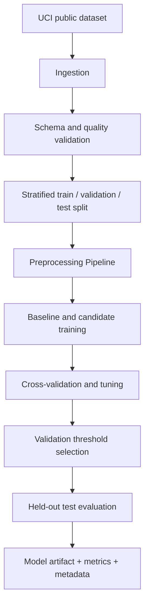
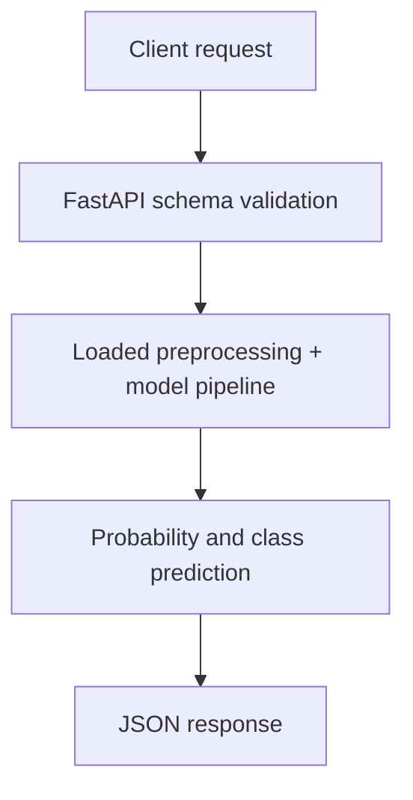

# Architecture

## Training lifecycle

## Inference lifecycle

## Production considerations
The local project demonstrates packaging, validation, testing, tracking, and serving. It does not implement production identity/access management, durable remote artifact storage, autoscaling, SLOs, drift alerting, or regulated model governance.
